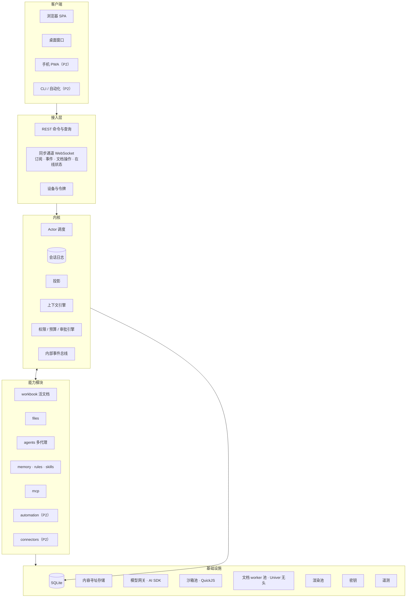
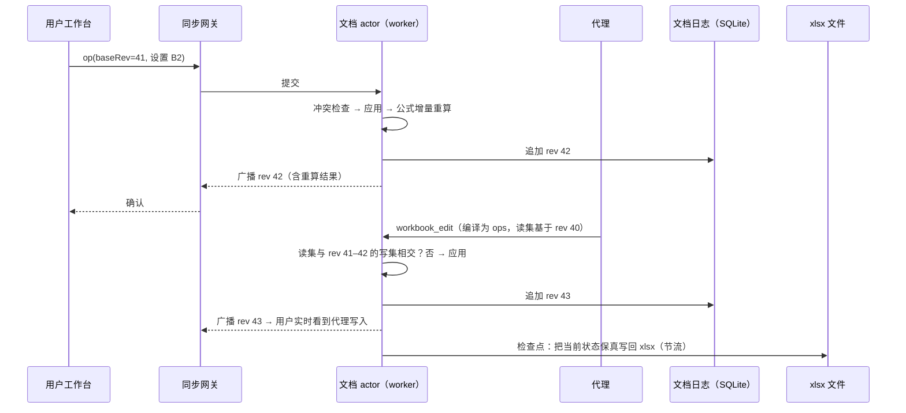
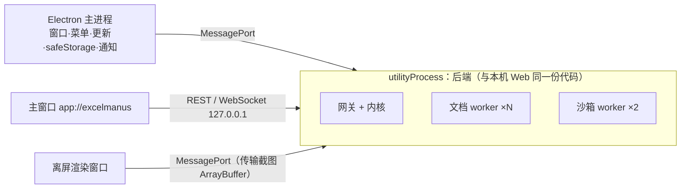

# 03 系统架构与选型

本章是整个系统的总纲。v1 的**功能范围**见 [01](01-product.md)，但架构按完整产品设计：多设备同时使用、手机连接电脑、服务器部署、自动化任务、数据连接器都必须能以"新增模块 / 新增客户端"的方式加入，不需要改动内核。

## 1. 架构目标

| 目标 | 含义 | 由什么保证 |
| --- | --- | --- |
| 一份事实 | 任何状态只有一个权威来源，其余都是可重建的投影 | 会话日志（§3.1） |
| 实时协作 | 用户、多个代理、多个客户端同时看同一个工作簿，变化以毫秒级互相可见 | 活文档（§3.2） |
| 细粒度并发 | 两个代理改同一工作簿的不同区域互不干扰；只有真正重叠的修改才冲突 | 区域级冲突检测（§6） |
| 可恢复 | 进程随时被杀，重启后从日志恢复，不丢失、不重放有副作用的操作 | 先写日志再执行效果（§3.1、§3.3） |
| 可扩展 | 新领域能力、新客户端、新部署形态不改内核 | 能力模块（§4.3）、同步网关（§4.1） |
| 成本可控 | 提示词缓存最大化、预算强制执行 | 上下文引擎（§4.2）、预算引擎 |
| 可观测 | 每个请求、步、工具调用、文档操作都可追踪 | 遥测（§9） |

## 2. 总览



## 3. 三个核心范式【硬性】

### 3.1 会话日志是唯一事实源，其余都是投影

每个会话有一条**只追加**的日志。会话中发生的一切都是日志中的一条记录：用户消息、派发、模型输出、工具调用意图、工具结果、审批请求与决定、代理间消息、代理状态变化、压缩、文件变更摘要。

```text
seq  agent   type                 data
101  main    user.message         {dispatchId, text, context…}
102  main    step.started         {step: 7, model, promptHash}
103  main    model.output         {text, reasoning, toolCalls:[c1]}
104  main    tool.intent          {callId: c1, tool: workbook_edit, targets, expectedRevs}
105  main    approval.requested   {callId: c1, preview}
106  main    approval.decided     {callId: c1, decision: approve}
107  main    tool.result          {callId: c1, status: ok, docRevs: {d3: 42}, changes…}
108  lead-1  inbox.delivered      {from: main, messageId…}
```

从这条日志派生出所有投影：

| 投影 | 用途 | 形式 |
| --- | --- | --- |
| 模型上下文（transcript） | 下一步发给模型的消息序列 | 按代理增量维护，可随时从日志重建 |
| 界面时间线 | 前端展示与重放 | 就是日志本身（加少量派生字段） |
| 待处理交互 | 待审批、待回答、排队消息 | 物化表，随日志更新 |
| 代理状态 | 团队视图、调度 | 物化表 |
| 会话列表、用量、变更摘要 | 列表与统计 | 物化表 |

规则：

- 写日志与更新物化投影在**同一个 SQLite 事务**中完成；事务提交后才推送给客户端。
- 物化投影可以删除后从日志重建（提供重建命令，CI 中测试"重建结果 = 增量结果"）。
- 流式增量（逐字文本、工具参数片段）不写日志，只经同步通道推送；段落完成时写一条完整记录。
- 这取代了上一版"对话记录表 + 事件表在同一事务中写"的双事实设计。

### 3.2 活文档：工作簿在内存中被共同编辑

工作簿打开后成为一个**活文档**：由一个文档 actor 持有其内存模型，所有修改——用户在工作台里的编辑、代理的工具调用、脚本的批量写入——都以**操作（operation）**的形式提交给它，按顺序应用，分配递增的**修订号**（revision），并实时广播给所有订阅该文档的客户端与代理。



要点：

- **文档日志先落库（毫秒级），xlsx 文件由检查点异步写回**。代理写入在检查点前即算已提交；进程崩溃时，重启后把日志中晚于最后一次检查点的操作重放到文件上。
- 检查点时机：代理的一次工具调用提交后 1 秒内；用户编辑停止 2 秒后；文档关闭、应用退出时。
- 用户在其他软件中修改了文件（外部修改）：检测到后，若文档没有未写回的操作，直接重新加载；若有，暂停写回并让用户选择"保留应用中的版本 / 载入外部版本"（另一份另存到备份区）。
- 修订号是应用内的版本标识；文件内容哈希只用于检测外部修改和备份去重。
- 模型与工具只看到修订号和区域，不需要理解操作格式（ChangeSet 在服务端编译为操作，[06 §4.3](06-tools.md#43-workbook_editwrite)）。

详细设计见 [07](07-workbook-engine.md)。

### 3.3 Actor 运行模型

系统中有状态的对象都是 **actor**：拥有私有状态和一个邮箱，逐条串行处理消息，actor 之间只通过消息通信。

| Actor | 数量 | 状态 | 运行位置 |
| --- | --- | --- | --- |
| Session | 每个活跃会话 1 个 | 会话日志写入权、团队名册、订阅者 | 主线程 |
| Agent | 每个代理 1 个 | 轮状态机、收件箱 | 主线程（模型调用是异步 IO） |
| Document | 每个打开的工作簿 1 个 | 内存模型、修订号、公式引擎、在线用户 | 文档 worker（按文档分片） |
| Job（P2） | 每个自动化任务 1 个 | 触发条件、运行记录 | 主线程 |

- 一个 actor 的消息处理不会与自身并发，因此不需要锁。原先分散的"每文件写锁""每代理串行队列"统一为同一机制。
- 副作用（调用模型、执行工具、写文件）遵循 **意图 → 执行 → 结果** 三段：先在日志写 `intent`，再执行，再写 `result`。崩溃后看到有 `intent` 无 `result` 的记录，按工具的 `replay` 声明处理（[04 §8](04-agent-runtime.md#8-中断与恢复)），永不盲目重放。
- actor 空闲超过阈值时从内存卸下（文档先做检查点），需要时从日志与快照重新唤起。
- 不引入外部持久工作流引擎：2026-09 核实，DBOS（TS 版需 Postgres）、Restate、Inngest 都需要独立服务，不能嵌入单机 SQLite。会话日志 + actor 足以提供所需的持久执行语义。

## 4. 各层职责

### 4.1 接入层（Gateway）

| 组件 | 职责 |
| --- | --- |
| REST | 命令（发送消息、审批、创建/修改资源）与查询（列表、详情、分页历史）。命令幂等（`clientMessageId` / `Idempotency-Key`） |
| 同步通道 | 一条 WebSocket 承载多个订阅：`session:<id>`（会话日志 + 流式增量）、`doc:<id>`（文档操作 + 在线状态）、`app`（全局变化）。每个订阅带游标，断线重连后从游标续传 |
| 设备与令牌 | 每个客户端是一个设备，持有独立令牌（库中只存哈希，可吊销）。本机 Web 将令牌封装进 HttpOnly 会话 Cookie，CLI/桌面使用 Bearer；WebSocket 用 REST 换取的一次性短期票据建立（浏览器 WebSocket 不能自定义请求头） |
| 在线状态 | 谁（哪个客户端、哪个代理）正在看/改哪个文档的哪个区域，用于协作光标 |

同步协议细节见 [11](11-api-contract.md)。客户端之间没有差别：桌面窗口、浏览器标签、将来的手机与 CLI 都是网关的普通客户端。

### 4.2 内核（Kernel）

| 组件 | 职责 |
| --- | --- |
| Actor 调度 | 创建、唤起、卸下 actor；邮箱；超时与取消信号传播 |
| 会话日志存储 | 追加记录、事务内更新投影、按游标读取 |
| 上下文引擎 | 从日志投影组装模型请求：冻结的系统提示词 + 只追加的历史 + 本轮 `<context>`；计算 token 占用；触发压缩；保证请求前缀稳定以命中缓存（[04 §7.3](04-agent-runtime.md#73-缓存友好的前缀规则硬性)） |
| 策略引擎 | 权限模式、审批判定、自动批准规则、角色裁剪、预算与失控检测。所有判定从工具声明派生（[06 §2.1](06-tools.md#21-每个工具必须声明硬性)） |
| 效果执行器 | 执行工具调用：写意图、设超时与取消、记录结果、分配幂等键 |
| 内部事件总线 | 模块间的进程内通知（如"文档 d3 的 B2:B9 被用户修改"→ 通知读过该区域的代理） |

### 4.3 能力模块

能力（表格、文件、多代理、记忆……）以模块形式注册到内核。一个模块可以贡献：

```ts
// 示意
interface CapabilityModule {
  id: string;                               // "workbook"、"files"、"agents"…
  tools?: ToolDefinition[];                 // 模型工具（[06]）
  sdk?: SdkNamespace;                       // run_script 中的 SDK（由 tools 自动生成）
  logRecordTypes?: RecordSchema[];          // 本模块写入会话日志的记录类型
  projections?: Projection[];               // 本模块维护的物化投影
  routes?: RouteDefinition[];               // REST 端点
  topics?: TopicDefinition[];               // 同步通道订阅主题
  settings?: SettingsSchema;                // 设置项（设置页从 schema 生成）
  skills?: SkillSource;                     // 随模块提供的技能
  migrations?: Migration[];                 // 数据库迁移
  onStart?(ctx: KernelContext): Promise<void>;
  onStop?(): Promise<void>;
}
```

前端对应一个**界面扩展点注册表**：模块可注册工具卡片渲染器、侧栏页、设置页分组、右键菜单项、文件类型预览器。

v1 模块：`workbook`、`files`、`agents`、`memory`、`rules`、`skills`、`mcp`、`models`。后续模块在不改内核的前提下加入：

| 未来模块 | 做什么 | 依赖的内核能力 |
| --- | --- | --- |
| `automation` | 定时/文件到达时触发任务，无人值守运行会话；需要审批时通过通知推到手机 | Job actor、无界面会话、设备通知 |
| `connectors` | 数据库（PostgreSQL、MySQL、SQL Server）、HTTP API、云盘作为数据源，供 `workbook_analyze` 查询或导入到工作簿 | 工具、密钥、策略引擎（外部访问审批） |
| `pdf` / `docx` 等 | 其他文档类型的读取（产品决策移除了 Word 编辑，但保留以模块形式恢复读取能力的可能） | 工具、文件预览扩展点 |
| `review` | 表格审计：公式一致性、硬编码数字、跨表引用断裂的专项检查 | 工具、技能 |

**模块边界规则【硬性】**：模块之间不直接调用内部函数，只通过内核提供的接口（工具调用、事件总线、文档服务接口）交互。v1 不向第三方开放模块 API（第三方扩展走 MCP 与技能），但内部模块按此接口编写，将来开放时不需要重构。

### 4.4 基础设施

| 组件 | 职责 |
| --- | --- |
| SQLite | 会话日志、投影、文档日志、设置、凭据。单写者（主线程），小事务；`node:sqlite` 只有同步 API，因此单个事务必须短（目标 < 5 ms），大查询分页 |
| 内容寻址存储 | 附件、截图、文档快照、备份，按 SHA-256 存储去重 |
| 模型网关 | AI SDK 7 适配（[§5](#5-agent-内核的选择)、[09](09-models.md)） |
| 沙箱池 | QuickJS worker 预热池（[08](08-sandbox.md)） |
| 文档 worker 池 | 承载文档 actor：Univer 无头实例、xlsx 编解码、公式计算。默认 worker 数 = min(CPU 核数 − 1, 4)，文档按 ID 分片 |
| 渲染池 | 截图（宿主相关：Electron 离屏窗口 / 无头浏览器） |
| 密钥 | 主密钥与凭据加解密（[10 §4](10-data.md#4-密钥硬性)） |
| 遥测 | 追踪、日志、指标（§9） |

## 5. Agent 内核的选择

### 5.1 需要内核提供什么

| 需求 | 来源 |
| --- | --- |
| 十余家提供商（含 OpenAI 兼容的国产模型、本地模型）、流式、工具调用、视觉、思考、提示词缓存 | [09](09-models.md) |
| 审批暂停可跨进程重启 | [04 §5](04-agent-runtime.md#5-权限与审批) |
| 在步骤边界注入用户追加消息、代理间消息、文档变化通知 | [04 §4](04-agent-runtime.md#4-消息派发)、[05](05-multi-agent.md) |
| 中断并干净收尾 | [04 §4](04-agent-runtime.md#4-消息派发) |
| 压缩、缓存友好的前缀 | [04 §6–7](04-agent-runtime.md#6-上下文管理与压缩) |
| 多代理并发与通信 | [05](05-multi-agent.md) |
| 每一步都写入我们的会话日志 | §3.1 |

后五项是产品特有语义，任何框架都不按这个形状提供；强行套用会重演旧项目"绕开框架某条路径、丢掉该路径能力"的问题。第一项（提供商适配）最费力、最需要社区维护。

### 5.2 决定【推荐】

- **模型网关**：Vercel AI SDK 7（`ai` + 官方 provider 包）。只使用**单步**能力：每次 `streamText` 让模型生成一步，工具不提供 `execute`，工具调用交回给我们的效果执行器。
- **运行时**：产品自有的 Agent actor（[04](04-agent-runtime.md)），核心代码量预计 2,000–3,000 行，每个状态转换可单测。
- 两者之间是一个窄接口，运行时与日志只使用产品自有的中立消息格式；格式转换只在网关适配器内：

```ts
interface ModelGateway {
  step(req: {
    model: ResolvedModel;
    system: FrozenSystemPrompt;
    history: ContextItem[];
    tools: ToolSpec[];            // 名称 + 说明 + JSON Schema，不含执行函数
    reasoning?: ReasoningLevel;
    cacheHints: CacheBreakpoint[];
    signal: AbortSignal;
  }): AsyncIterable<StepEvent>;   // 文本/思考/工具参数增量、完成、用量、错误
}
```

- 遥测：AI SDK 7 的 `telemetry` 选项与 `@ai-sdk/otel` 集成输出 OpenTelemetry span（含每步 token 与延迟），接入 §9。

### 5.3 被排除的方案

| 方案 | 原因 |
| --- | --- |
| fork 上游 pi 并改造 | 旧项目的主要痛点来源 |
| CLI 型编码代理作内核（pi coding-agent、Claude Agent SDK、Codex app-server、opencode） | 为编码场景设计：内置 shell 与文件编辑工具、自有会话存储；绑定单一提供商或以子进程运行、状态在我们的日志之外；工具面与审批 UI 难以深度定制 |
| OpenAI Agents SDK（0.16） | 非 OpenAI 提供商适配仍为 beta；多代理原语是 handoff 与阻塞式 agent-as-tool，不是并发通信的代理 |
| Mastra（1.70） | 完整框架，自带记忆、存储与工作流，与我们的日志与审批语义重叠；`network()` 已被官方弃用 |
| LangGraph.js | 图抽象与检查点模型与会话日志重复 |
| DBOS / Restate / Inngest | 需要 Postgres 或独立服务，不能嵌入单机 |

## 6. 一致性模型【硬性】

### 6.1 文档内

- 文档 actor 是该文档的**唯一写入者**，所有操作串行应用，修订号严格递增。
- 每次提交携带 `baseRev`（提交者看到的修订号）和**读集**（提交者依据读过的区域）。代理的读集由运行时自动记录（它在 `baseRev` 时调用 `workbook_read` 读过的区域）；用户编辑的读集就是写入的单元格本身。
- 提交被接受的条件：`baseRev` 之后的所有操作的**写集**与本次提交的**读集 ∪ 写集**不相交。
- 被拒时返回 `VERSION_CONFLICT`，附**具体哪些单元格被谁在哪个修订改了**，代理只需重读这些区域。
- 结构操作（插入/删除行列、删除/重命名工作表）改变坐标：
  - 对于 `baseRev` 早于某结构操作的提交，若坐标可以确定性地变换（行列平移），则自动变换后再检查；
  - 不能确定性变换（被删除的区域正好是目标区域）则拒绝。
- 结果：12 个子代理往同一份汇总表的不同工作表写入不再互相冲突；用户改 A 列时代理改 F 列也不冲突。

### 6.2 文档与会话之间

- 工具结果中记录它产生的文档修订号，会话日志因此可以回答"这一步改到了哪个修订"。
- 变更摘要按修订区间从文档日志生成，而不是由模型自述。
- 读过某区域的代理，在该区域被其他人修改后，会在下一个步骤边界收到一条简短通知（"用户修改了 汇总!B2:B9"），而不是等到写入冲突时才发现。通知合并去重，每步最多一条。

### 6.3 跨文档

- 不提供跨文档事务。`run_script` 的多文件发布与多文件工具操作逐文档提交；任一文档提交失败时，已提交的文档用同一批次的撤销操作回退（撤销操作由文档 actor 在应用时同步生成，保存在批次记录中）。这比依赖整文件备份更轻、更精确。

## 7. 进程与线程

### 7.1 本机 Web

一个 Node 进程：主线程运行网关、内核与 Agent/Session actor；worker 线程运行文档、沙箱、分析任务。

### 7.2 桌面



- 大块数据（截图、快照）通过 `MessageChannelMain` 端口以可转移的 `ArrayBuffer` 传递，避免复制。
- 前端通过自定义协议 `app://excelmanus/` 加载，来源稳定（[13 §1.1](13-desktop-mobile.md#11-稳定的前端来源)）。

### 7.3 服务器（P2）

同一后端，监听非回环地址，启用登录保护；文档 worker 与沙箱 worker 数按机器配置；渲染使用无头 Chromium。仍是单用户实例。

## 8. 端到端数据流示例

**用户说"把 C 列日期统一成 yyyy-mm-dd"**：

1. 前端 `POST /messages`（带当前选区与文档修订号）→ Session actor 写 `user.message` → 推送。
2. Agent actor 开始一轮：上下文引擎组装请求（冻结前缀 + 追加的用户消息与 `<context>`）→ 模型网关流式返回 → 增量推送 → 写 `model.output`。
3. 模型调用 `workbook_read`（range C1:C240）→ 效果执行器 → 文档 actor 返回数据与 `rev 57`，运行时把 `C1:C240@57` 记入该代理的读集。
4. 模型调用 `ask_user`（区域确认 C2:C240）→ 写 `question.asked` → 工作台高亮 → 用户确认 → `question.answered`（带 `rev 57`）。
5. 模型调用 `workbook_edit`（格式与值转换）→ 写 `tool.intent` → 策略引擎：`standard` 模式，自动 → 首次修改该文件 → 备份 → 编译为操作 → 文档 actor 检查读集（rev 57 之后无人改过 C 列）→ 应用为 `rev 58` → 广播：用户在工作台上实时看到 C 列逐批变化（大批量操作按 500 单元格分片广播）→ 写 `tool.result`。
6. 1 秒内检查点写回 xlsx。
7. 本轮结束：变更摘要由 `rev 57→58` 的文档日志生成 → 推送。

## 9. 可观测性

- **追踪**：OpenTelemetry。一次用户消息是一条 trace，包含每一步（模型调用 span 带 token、缓存命中、延迟）、每个工具调用、每个文档操作。
- **本地追踪查看器**：设置 → 诊断 中可按会话查看步骤时间线、每步请求大小与缓存命中率、工具耗时（开发与排障用，不上传）。
- **日志**：结构化 JSON，带 trace/session/agent/tool-call ID；脱敏（不含密钥、文件内容、提示词正文）。
- **指标**：活跃 actor 数、事件推送延迟、SQLite 事务耗时 p99、文档检查点耗时、沙箱排队长度。
- **诊断包导出**：用户可导出最近日志与追踪（脱敏）用于反馈问题。

## 10. 技术选型

| 领域 | 选型 | 级别 | 理由 / 备选 |
| --- | --- | --- | --- |
| 语言 | TypeScript（strict），ESM | 硬性 | 产品决策 |
| 运行时 | Node.js ≥ 24 | 推荐 | Electron 44 内置 Node 24；`node:sqlite` 无需 flag |
| 单仓 | pnpm workspaces | 推荐 | 备选 npm workspaces |
| 模型网关 | Vercel AI SDK 7 + 官方 provider 包 | 硬性（成熟库）/ 推荐（具体库） | §5 |
| Schema | Zod 4 | 推荐 | AI SDK 原生支持；导出 JSON Schema |
| HTTP / WebSocket | Hono + `@hono/node-server`（内置 WebSocket 升级，底层 `ws`） | 推荐 | `@hono/node-ws` 已废弃；备选 Fastify + `@fastify/websocket` |
| 数据库 | SQLite（`node:sqlite`，WAL，FTS5） | 推荐 | 实测 WAL、多连接、worker 内使用、FTS5 均可用；备选 `better-sqlite3` |
| 查询层 | Kysely + 手写迁移 | 推荐 | 备选 Drizzle |
| 活文档模型 | **Univer 无头实例作为服务端文档模型**，操作即 Univer mutation | 推荐（需 M0 验证） | 见 [07 §2](07-workbook-engine.md#2-文档模型的选择)；备选：自有模型 + 双向映射 |
| xlsx 编解码 | 自研保真编解码：xlsx ↔ Univer 快照 + 保留部件清单 | 推荐 | [07 §4](07-workbook-engine.md#4-xlsx-编解码) |
| 公式计算 | Univer 公式引擎（增量，依赖标脏） | 推荐 | 与工作台同一引擎 |
| 数据分析 | SQLite 内存库（worker） | 推荐 | DuckDB 为 P2 大数据选项 |
| 代码沙箱 | QuickJS（`quickjs-emscripten`）in `worker_threads` | 推荐 | [08](08-sandbox.md) |
| 前端 | React 19 + Vite；TanStack Router/Query；Zustand | 推荐 | |
| 表格工作台 | Univer 开源版（与服务端同一版本，锁定） | 推荐 | |
| UI | Tailwind CSS 4 + shadcn/ui | 开放 | 组件为在 Radix 原语上自写的 shadcn 风格层，lightningcss 为负责人批准的构建期许可例外（ADR 0011） |
| 桌面 | Electron 44+、electron-builder、electron-updater | 推荐 | |
| MCP | `@ai-sdk/mcp` | 推荐 | 备选 `@modelcontextprotocol/sdk` |
| 遥测 | OpenTelemetry（`@ai-sdk/otel`） | 推荐 | |
| 测试 | Vitest、Playwright | 推荐 | |

**许可证约束【硬性】**：只使用 MIT、Apache-2.0、BSD、ISC 等宽松许可依赖。不得引入 `@univerjs-pro/*` 等商业许可组件（包括其协同、xlsx 导入导出、图表），不得使用 HyperFormula（GPLv3/商业）。CI 做许可证检查。

**版本锁定【硬性】**：前端与服务端的 Univer 必须是同一精确版本（操作格式由它定义），升级时两端同时升级并跑文档操作回放测试。

## 11. 代码组织【推荐】

```text
excelmanus-next/
  packages/
    protocol/       # 契约：REST DTO、日志记录类型、同步通道消息、工具结果、错误码
    core/           # 纯领域工具：ID、时间、结果类型、A1 地址、区域运算（无 IO）
    kernel/         # actor 调度、会话日志、投影框架、上下文引擎、策略引擎、效果执行器、事件总线、模块接口
    models/         # 模型网关：AI SDK 适配、提供商预设、订阅登录、能力探测、models.dev 快照
    modules/
      workbook/     # 活文档：文档 actor、xlsx 编解码、ChangeSet 编译、读取投影、分析、渲染接口
      files/
      agents/       # 多代理：团队、收件箱、租约、预算
      memory/  rules/  skills/  mcp/
    sandbox/        # QuickJS worker 与 SDK 桥
    server/         # 网关（REST + WebSocket）、设备与令牌、宿主适配接口、启动装配
    web/            # 前端 SPA 与界面扩展点注册表
    desktop/        # Electron
  assets/  skills/  samples/  fixtures/
  docs/
```

依赖方向【硬性】：`protocol`、`core` 不依赖其他包；`modules/*` 只依赖 `kernel` 的公开接口、`protocol`、`core` 与基础设施包，模块之间不互相依赖；`web` 只依赖 `protocol` 与 `core`。CI 强制检查，禁止循环依赖。

## 12. 宿主适配接口

| 能力 | 本机 Web | 桌面 | 服务器（P2） |
| --- | --- | --- | --- |
| 选择文件夹 | 输入路径（校验） | 系统对话框 | 输入路径（限制在允许的根目录下） |
| 主密钥保护 | 0600 文件 | `safeStorage` | 环境变量或密钥文件 |
| 截图渲染 | 借用已连接的浏览器页签；否则连接系统 Chrome/Edge | Electron 离屏窗口 | 无头 Chromium |
| 系统通知 | 浏览器通知 | 系统通知 | 推送到已配对设备（P2） |
| 自动更新 | 不支持 | electron-updater | 部署脚本 |

## 13. 安全模型

| 边界 | 措施 |
| --- | --- |
| 本机其他程序/网页 → 后端 | 只监听 `127.0.0.1`；设备令牌；WebSocket 用一次性票据；校验 `Host` 与 `Origin`；CORS 只允许自身来源 |
| 模型 → 文件系统 | 路径规范化、禁止越出工作区、拒绝外指符号链接、隐藏 `.excelmanus/` |
| 模型 → 代码执行 | 仅 QuickJS 沙箱 |
| 模型 → 外部服务 | MCP 与（P2）连接器，默认需审批 |
| 密钥 | 主密钥保护 + AES-256-GCM；日志脱敏 |
| 桌面渲染进程 | `contextIsolation`、`sandbox`、禁用 `nodeIntegration`、白名单 IPC、导航限制 |
| 提示词注入 | 文件内容与 MCP 结果在上下文中以数据块标记来源；高风险操作（删除、外部调用）始终受权限模式约束，不因模型输出而放宽 |

## 14. 相比上一版的变化

| 上一版 | 本版 | 原因 |
| --- | --- | --- |
| 以文件为中心，每次写入重写整个 xlsx，整文件版本哈希 | 活文档：内存模型 + 文档日志 + 异步检查点；修订号 | 用户逐格编辑与代理写入的成本；实时协作 |
| 整文件级版本冲突 | 区域级冲突检测 + 结构操作坐标变换 | 多代理与用户并行不再互相阻塞 |
| 对话记录表与事件表双写 | 会话日志唯一事实源 + 可重建投影 | 消除双事实 |
| SSE 单向推送 | WebSocket 同步通道（多订阅、游标续传、文档操作、在线状态） | 协作编辑需要双向低延迟 |
| 自有工作簿模型 + 到 Univer 的转换器 | Univer 无头实例作为服务端文档模型 | 界面、代理、公式、截图天然一致；少一层映射 |
| 领域能力直接写在包里 | 能力模块接口 + 前端扩展点 | 自动化、连接器、新文档类型可按模块加入 |
| 每文件写锁、每代理队列等多种并发机制 | 统一 actor 模型 | 一种机制，易推理 |
| 单文件整包备份作为唯一回退 | 保留修改前备份；另外文档 actor 为每个批次生成撤销操作，用于多文档批次失败回退 | 更精确的失败处理（不对用户承诺撤销历史） |
| 无追踪 | OpenTelemetry + 本地追踪查看器 | 成本与性能问题可诊断 |
