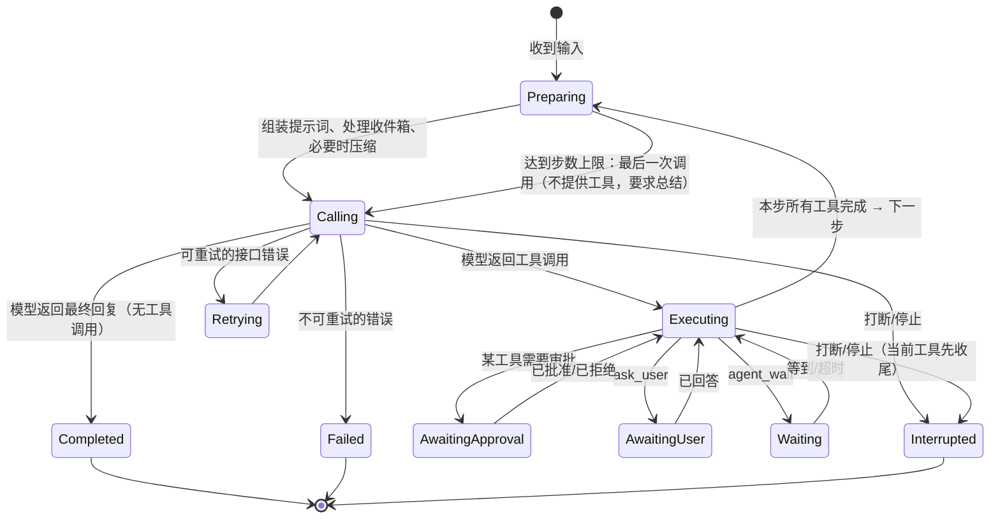

# 04 Agent 运行时

运行时是产品自有代码，建立在模型网关（[03 §5](03-architecture.md#5-agent-内核的选择)）之上。主代理与子代理共用同一套运行时。

## 1. 概念

| 概念 | 定义 |
| --- | --- |
| 会话 Session | 用户可见的一次对话，绑定一个工作区，包含一个代理团队 |
| 代理 Agent | 一个执行者，有自己的对话记录与收件箱（[05](05-multi-agent.md)） |
| 轮 Turn | 代理从收到输入开始、到给出最终回复（或暂停/中断/失败）为止的过程 |
| 步 Step | 一次模型调用 + 该次调用产生的全部工具调用的执行 |
| 对话记录 Transcript | 代理的消息序列（用户、助手、工具结果、收件箱注入、压缩摘要），是**会话日志的投影**（`agent_context`，[10 §3.3](10-data.md#33-会话投影可重建)），可随时从日志重建 |
| 会话日志记录 / 流式增量 | 持久的状态变化写入会话日志；逐字文本、工具参数片段等瞬时增量只经同步通道推送（[11 §3.5](11-api-contract.md#35-会话日志记录类型推荐清单硬性持久瞬时的划分)） |

## 2. 执行模型【硬性】

- **每个代理是一个 actor**（[03 §3.3](03-architecture.md#33-actor-运行模型)）：同一时刻最多只有一轮在执行，所有状态变更（开始轮、写会话日志记录、处理收件箱、审批决定）在该 actor 的邮箱里串行处理，避免并发竞态。
- 不同代理（包括不同会话的代理）并行执行。
- **先持久化，再发布**：任何状态变化先写会话日志（与投影更新在同一事务中），事务提交后经同步通道推送。前端看到的一切都能从日志重建。

## 3. 轮的状态机

步的流程：

1. **Preparing**：`beforeStep` 钩子依次执行——取出收件箱中应在步骤边界注入的消息；取出 `context.notice`（文档变化通知，[03 §6.2](03-architecture.md#62-文档与会话之间)）一并追加；检查上下文占用，必要时压缩（§6）；确有变化时才更新工具列表（MCP 连接变化、模型视觉能力）；组装本步请求——系统提示词沿用会话冻结版本，新内容只追加（§7.3）。
2. **Calling**：调用模型网关，流式转发文本、思考与工具参数增量（流式增量 `delta`）。模型结束后，把完整的助手消息写入 `model.output` 日志记录。
3. **Executing**：按顺序执行本步的工具调用【推荐：v1 顺序执行；同一步内全部是只读工具时可并行，作为 P1 优化】。每个工具调用：`beforeTool`（审批、租约、备份）→ 写 `tool.intent` → 执行 → 写 `tool.result` → `afterTool`（变更摘要、界面推送）。读取类工具的结果区域（含返回的修订号）由运行时记入该代理的读集（[07 §10](07-workbook-engine.md#10-与代理的协作)）。
4. 本步全部工具完成后回到 Preparing。

单轮最大步数默认 200（主代理）/ 60（子代理），可设置；达到上限时再做最后一次模型调用：不提供任何工具，并追加一条说明要求模型总结当前进度与未完成事项，其回复即本轮最终回复，本轮以 Completed（原因：步数上限）结束。

## 4. 消息派发

### 4.1 三种策略【硬性】

用户在代理执行中发送消息时：

| 策略 | 行为 |
| --- | --- |
| `steer` 引导 | 不打断当前模型请求和工具执行，消息在下一个步骤边界注入对话，同一轮继续 |
| `interrupt` 打断 | 取消当前模型请求；正在执行的工具收到取消信号并收尾（已提交的写入保留）；当前轮以 Interrupted 结束；随后以该消息开始新一轮 |
| `queue` 排队 | 当前轮结束后，按先后顺序各自开始新一轮 |

- `interrupt` 与停止时，正在执行的工具收尾后的**真实结果照常写入对话记录**（成功、失败或 `CANCELLED`），本步尚未开始的工具调用写入"未执行"结果，然后本轮才以 Interrupted 结束。下一轮的模型因此能看到被打断前实际发生了什么。
- 默认策略在设置中配置（默认 `steer`），每条消息可临时覆盖。
- 代理空闲时，三种策略都等同于直接开始新一轮。
- 代理处于等待审批/等待回答时：`steer` 消息在审批决定后的下一个步骤边界注入；`interrupt` 会取消待审批请求（视为拒绝，理由"用户发送了新指令"）后开始新一轮；`queue` 照常排队。
- 当前轮在 steer 消息被注入前就结束了：该消息自动转为下一轮的输入，不能丢。

### 4.2 停止

"停止"与"打断"分开：停止 = 打断但不发送新消息。停止后排队中的消息**不自动开始**，输入框上方显示"有 N 条排队消息"，用户点"继续发送"或逐条撤回。

### 4.3 派发记录与幂等【硬性】

- 每条用户消息携带客户端生成的 `clientMessageId`。服务端以 `(sessionId, agentId, clientMessageId)` 去重：重复提交返回原记录；同 ID 不同内容返回冲突错误。
- 派发记录状态：`accepted → queued → applied`，或 `cancelled`（用户撤回，仅限未应用）、`failed`（附原因）。状态变化写 `dispatch.updated` 日志记录并经同步通道推送，前端据此显示用户消息下方的状态。
- 附件与选区上下文在派发受理前完成校验（附件已上传、选区引用的文档与修订号有效），校验失败则派发直接 `failed`，不进入队列。

## 5. 权限与审批

### 5.1 权限模式【推荐：三档及默认值；硬性：删除与外部调用在前两档必须审批】

| 模式 | 读取 | 写入工作区文件 | 删除（移入回收站） | MCP 外部工具 |
| --- | --- | --- | --- | --- |
| `confirm`（每次写入前确认） | 自动 | 审批 | 审批 | 审批 |
| `standard`（默认） | 自动 | 自动（修改已有文件前自动备份） | 审批 | 审批（自动批准名单除外） |
| `auto`（完全自动） | 自动 | 自动 | 自动 | 自动 |

- 会话可以覆盖全局默认模式；子代理不超过父代理（[05 §5](05-multi-agent.md#5-角色与权限)）。
- 审批时可选"本会话同类操作自动批准"，生成一条会话级规则（工具名 + 目标路径模式），在界面上可查看和撤销。
- 模式切换即时生效，下一次工具调用按新模式判断。

### 5.2 审批流程【硬性】

1. `beforeTool` 判定需要审批 → 写 `approval.requested` 日志记录（含工具、参数、目标、预览引用）→ 待审批投影 `pending_interactions` 更新 → 代理状态变为 `blocked` → 经同步通道推送。当前轮在此**暂停**，不占用任何执行资源。
2. 用户决定（批准/拒绝，可附理由）→ 写 `approval.decided` 日志记录 → 在代理的串行队列中恢复：批准则执行工具（执行前重新检查冲突与租约），拒绝则写入工具结果 `APPROVAL_DENIED`（含理由）→ 继续该步剩余工具 → 下一步。
3. 重复提交决定是幂等的：已决定的审批返回原决定。
4. **进程重启后，待审批记录仍然有效**。代理保持 `blocked`，用户仍可批准，批准后照常恢复执行。这与"运行中被中断"不同（§8）。
5. 同一步多个工具调用需要审批时，逐个请求，前一个决定后再请求下一个。

## 6. 上下文管理与压缩

### 6.1 预算

- 每个模型档案有上下文窗口（来自 models.dev 快照、能力探测或用户填写）。
- 每步调用后用接口返回的用量记录当前占用；未返回用量的提供商用估算（按字符数估算，明确标记为估算）。
- 前端显示占用比例。

### 6.2 历史只追加【硬性】

压缩之外，**不改写已经发送给模型的对话历史**：不删除、不截短、不用占位符替换较早的工具结果或图片。原因：

- 改写历史前缀会使提示词缓存从改写点起全部失效，之后每一步都要按全价重新计算，总成本反而上升。
- 模型会发现自己之前看到的内容"变了"，导致困惑或重复读取。

因此控制上下文增长只靠两件事：工具结果在**产生时**就有大小上限（[06 §2.3](06-tools.md#23-统一结果结构硬性)），以及下面的压缩。

### 6.3 压缩【推荐：阈值；硬性：只在此处改写历史】

| 情况 | 动作 |
| --- | --- |
| 占用 ≥ 80% | **压缩**：调用摘要模型，把压缩点之前的对话替换为结构化摘要，保留最近约 20% 窗口的原文 |
| 接口报上下文超限 | 立即压缩后重试该步一次 |

压缩是唯一一次性、明确的历史改写：之后的对话又从新前缀开始只追加，缓存重新累积。

结构化摘要必须包含【硬性】：用户目标与约束、已做出的决定、涉及的文件及最后已知修订号、未完成的待办、用户明确说过的偏好、重要中间结果（如识别出的表头口径）。摘要不能把"推测"写成"事实"。

- 压缩在步骤边界进行，产生一条压缩记录（压缩前后 token 数、摘要正文），界面显示为"已压缩上下文"块，可展开查看摘要。
- 手动压缩：`/compact` 或界面按钮。
- 可设置关闭自动压缩（关闭后到达上限时报错提示用户手动处理）。

## 7. 提示词分层

### 7.1 三层分工【硬性】

| 层 | 负责 | 不负责 | 位置 |
| --- | --- | --- | --- |
| **系统提示词** | 身份、通用行动原则（先观察再修改、写入基于读过的修订、冲突时重读、如实报告、不确定时询问）、权限说明、环境信息 | 任何具体工具的参数与用法；任何具体业务流程 | `runtime` 包中的提示词模块 |
| **工具说明** | 这个工具做什么、作用范围、参数语义、错误处理、最小示例 | 多步骤业务流程；其他工具的用法 | 每个工具定义内（[06 §2](06-tools.md#2-工具定义规范)） |
| **技能** | 某一类任务的工作方法：步骤、判断要点、质量标准、常见陷阱（如"做月度报表"、"截图转表格"、"数据清洗"） | 重复工具参数说明；声明新工具 | `assets/skills/<名称>/SKILL.md` |

检查规则（CI 自动执行）【硬性】：

- 技能正文中出现的工具名必须存在于当前工具目录；技能必须在 frontmatter 声明 `requires-tools`，工具不可用时技能不出现在列表中。
- 系统提示词中不得出现具体工具的参数名。
- 工具说明中不得出现其他工具的参数细节（可以写"改用 `workbook_analyze`"）。

### 7.2 系统提示词的组成与顺序【推荐】

1. 身份与通用原则（按角色：main / lead / worker / reader）
2. 权限模式说明
3. 可用技能索引（名称 + 一句话 + 何时使用）
4. 用户规则（全局 + 会话）
5. 工作区信息（工作区名称、会话开始日期）
6. 子代理的任务说明（仅子代理）

- 工具列表通过模型接口的工具参数传递，不在系统提示词里重复。
- 对支持显式缓存标记的提供商（如 Anthropic），在系统提示词末尾和对话历史末尾设置缓存断点。

### 7.3 缓存友好的前缀规则【硬性】

与 [§6.2](#62-历史只追加硬性) 同一原则：模型请求的前缀（工具列表 + 系统提示词 + 已有历史）在会话中保持不变，新内容只追加在末尾。

- **系统提示词在会话中冻结**：会话开始（或压缩后）时生成一次。中途变化的设置（权限模式、规则、技能启用状态、日期跨天）不重写系统提示词，而是作为一条简短的"环境变化"说明**追加**到对话中；下次压缩时再合并进新的系统提示词。
- **每轮变化的上下文随用户消息追加**：相关记忆（[12 §2.3](12-skills-memory-mcp.md#23-使用推荐)）、当前打开的工作簿与选区、`@` 引用的区域，放在该轮用户消息前的 `<context>` 块中，而不是放进系统提示词。
- **工具列表尽量稳定**：只在确有变化时（MCP 服务器连接/断开、模型切换导致视觉能力变化）更新；这会使缓存失效一次，属于可接受的例外。
- 验收：在支持缓存用量回报的提供商上，同一会话连续 10 步的缓存命中比例应随步数上升；由提供商回放测试检查请求前缀是否逐步只追加（[14 §3.2](14-quality.md#32-提供商回归)）。

## 8. 中断与恢复

### 8.1 意图与结果记录【硬性】

**所有**工具调用（不只写入类）执行前写一条 `tool.intent` 日志记录（含参数、目标、`replay` 声明），完成后写 `tool.result`（状态 `ok` / `error` / `partial` / `not_executed` / `uncertain`）。两者之间的差集即 `open_intents` 投影（[10 §3.3](10-data.md#33-会话投影可重建)）。

### 8.2 启动时恢复

进程启动时，对所有 `running` 状态的代理，以 `open_intents` 投影（有 `tool.intent` 而无 `tool.result` 的调用）为输入：

| 发现的情况 | 处理 |
| --- | --- |
| 模型请求进行中 | 丢弃未完成的助手消息；已流出的工具调用标记为**未执行** |
| 只读工具的 `tool.intent` 无 `tool.result` | 标记为**未执行** |
| 工作簿写入工具的 `tool.intent` 无 `tool.result` | 查 `doc_ops` 中是否存在该 `tool_call_id` 的修订：存在 → **已提交**（从修订重建结果，状态 `ok`）；不存在 → **未执行** |
| 其他写入类工具（`files`、`write`/`edit` 文本文件、MCP）的 `tool.intent` 无 `tool.result` | 目标文件内容哈希与意图记录的预期一致 → **未执行**；否则 → **结果不确定**，提示"文件可能已被修改，请重新读取后再继续" |
| `run_script` 进行中 | 查 `doc_ops` 中该 `tool_call_id` 的修订与文本暂存状态：都没有提交 → **未执行**（缓冲的 ChangeSet 与暂存清理）；部分文档已提交 → **结果不确定**（发布机制见 [08 §4](08-sandbox.md#4-设计推荐)） |

然后把代理状态设为 `interrupted`，为每个未完成的工具调用写入合成的工具结果（说明上述状态），经同步通道推送。

`blocked`（等待审批/回答）的代理保持 `blocked`，不视为中断（§5.2）。

### 8.3 继续

用户点"继续"（或输入 `/resume`，或给该代理发任何消息）时，代理以已持久化的对话记录开始新一步。模型会看到合成的"未执行 / 结果不确定"工具结果，并据此决定下一步。**运行时永远不自动重放写入。**

### 8.4 模型流中断

模型流式输出中途失败（网络中断、服务端错误）：已流出的文本与工具参数不写入日志，写一条 `attempt.discarded` 记录，前端据此清除对应的临时显示；按 §9 重试。重试耗尽后本轮以 Failed 结束，已流出的工具调用卡片定为**未执行**。

## 9. 错误与重试

| 错误类别 | 重试 | 界面 |
| --- | --- | --- |
| 网络错误、429、5xx、流中断 | 指数退避，最多 5 次，尊重 `Retry-After` | 重试提示块 |
| 上下文超限 | 压缩后重试 1 次 | 压缩块 |
| 认证失败、额度不足、模型不存在、请求参数不被支持 | 不重试 | 错误指引块（去设置 / 换模型） |
| 内容安全拒绝 | 不重试 | 显示原因 |

- OAuth 令牌过期：先刷新令牌再重试一次，刷新失败归为认证失败。
- 错误信息给用户看分类与建议，原始错误摘要可展开，**不包含密钥**。

## 10. 思考内容与多模态

- 思考（reasoning）内容以提供商原始格式的附加数据一并保存在对话记录中（部分提供商要求后续请求回传，如 DeepSeek 的 `reasoning_content`、Anthropic 的思考签名）。回传规则由模型网关按提供商处理，并有针对每个提供商的回归测试（[14 §3](14-quality.md#3-测试分层)）。
- 用户选择的思考强度映射到 AI SDK 的统一 `reasoning` 选项；模型不支持时不发送并提示。
- 图片附件：保存到附件存储，发送给支持视觉的模型；模型不支持视觉时，消息中以文字说明"附件图片未发送：当前模型不支持图片"，并在界面提示。
- `workbook_render` 返回的图片同样作为视觉输入；进入历史后不再改动，只在压缩时随压缩点之前的内容一起被摘要取代（摘要中保留"看过哪个版本、哪个区域的截图及结论"）。

## 11. 每轮结束

`afterTurn` 钩子：

1. 根据本轮产生的文档修订区间，从文档日志生成**变更摘要**（文件、工作表、单元格数量、结构变化、新增对象、备份位置），写一条 `change.summary` 日志记录（不发给模型）。
2. 子代理：向父代理发送完成报告（[05 §4.3](05-multi-agent.md#43-完成报告)）。
3. 会话第一轮结束后生成标题：取用户首条消息前 30 个字作为临时标题；可选用小模型生成（设置项，默认关闭以免额外费用）。
4. 更新用量统计。
5. 若有排队消息，开始下一轮。
