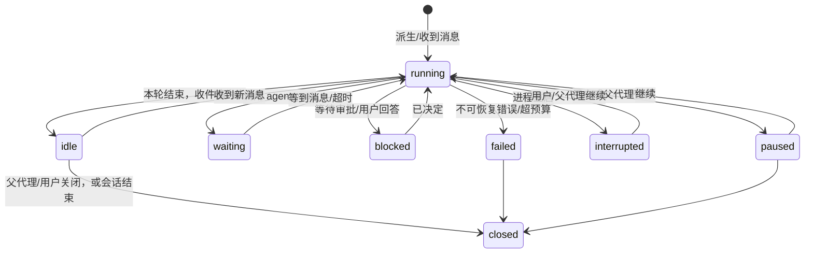

# 05 多代理协作

## 1. 目标

旧设计：主代理调用"派发子任务"，要么阻塞等待结果，要么在后台跑完后只能被查询状态；子代理之间不能沟通，主代理也不能在子代理运行中补充信息。

新设计【硬性】：

1. 派生子代理**不阻塞**派生者。
2. 父子、兄弟代理之间可以**互相发消息**；消息异步投递，接收方在合适的时机处理。
3. 需要"等结果"时，代理显式调用等待工具，等待期间不消耗模型调用。
4. 用户能看到每个代理，能直接和任何一个代理对话、暂停或停止它。
5. 全程可持久化、可恢复，有预算上限，不会失控。

## 2. 概念模型

```
会话 Session（绑定一个工作区，用户与之对话）
 └─ 团队 Team（会话内所有代理）
     ├─ 主代理 main（用户直接对话的代理，根节点）
     │   ├─ 子代理 A（由 main 派生）
     │   │   └─ 子代理 A1（由 A 派生，受深度限制）
     │   └─ 子代理 B
     └─ 共享任务板（P1）
```

**代理（Agent）** 是一个独立的执行者，拥有：

| 属性 | 说明 |
| --- | --- |
| `id` / `name` | ID 全局唯一；名称在会话内唯一、人类可读（如"北京分公司整理"），消息寻址可用名称 |
| `parentId` | 派生者；主代理为空 |
| `role` | 角色模板，决定工具集和权限上限（§5） |
| `status` | 见 §3 |
| 对话记录 | 独立的消息历史（不共享父代理的历史） |
| 收件箱 | 待处理的消息队列（§4） |
| 模型档案 | 默认继承会话设置中的"子代理默认模型"，派生时可指定 |
| 预算 | 步数、token、墙钟时间上限 |
| 文件租约 | 声明自己负责写入的文件（§6） |

主代理与子代理**使用同一套运行时**（见 [04](04-agent-runtime.md)），区别只在角色、工具集和预算。这意味着对话循环、审批、压缩、中断恢复只实现一次。

## 3. 代理状态



- `idle`：完成了当前工作、等待新消息，不消耗资源。子代理完成任务后进入 `idle` 而不是直接销毁，这样父代理可以追问或追加任务。
- `closed`：终态，不再接收消息。父代理用 `agent_control(close)` 或会话预算耗尽时进入。
- 子代理首次进入 `idle`（即完成初始任务）时，运行时自动向父代理发送**完成报告**（§4.3）。

## 4. 收件箱与消息

### 4.1 统一收件箱【硬性】

每个代理有一个持久化收件箱。下列输入全部通过收件箱进入代理：

| 消息类型 | 来源 | 示例 |
| --- | --- | --- |
| `user` | 用户（主代理或用户在代理视图里直接发） | "先别改原表" |
| `agent` | 其他代理 | "我这边表头口径是：收入含税" |
| `report` | 运行时代发的子代理完成/失败报告 | "子代理 B 已完成：……" |
| `notice` | 运行时通知 | "子代理 A 预算耗尽已停止"、"所有子代理都在等待"、"用户修改了 汇总!B2:B9"（文档变化通知） |

用户消息的 steer/interrupt/queue 三种派发策略（[04 §4](04-agent-runtime.md#4-消息派发)）就是收件箱的三种投递方式。代理间消息默认按 **steer** 语义投递（在下一个步骤边界注入），发送者可以指定 `urgent`（按 interrupt 语义）。

### 4.2 投递语义

- 消息写入会话日志（`inbox.sent`）后才算发送成功，返回消息 ID；投递时写 `inbox.delivered`。
- 接收方在**步骤边界**（一次模型调用及其工具执行全部结束之后、下一次模型调用之前）取出所有待处理消息，按优先级排序后作为一条"收到的消息"注入对话：`interrupt 用户消息 > 普通用户消息 > report/notice > agent 消息 > queue 用户消息`（queue 只在本轮结束后才取）。
- 接收方处于 `idle` 时，新消息立即唤醒它开始新一轮。
- 接收方处于 `waiting` 时，符合等待条件的消息唤醒它。
- 注入模型的格式【推荐】：

```text
<inbox>
<message id="m_41" from="子代理:北京分公司整理" kind="agent" at="10:32:05">
我这边表头口径是：收入含税，单位元。你那边如果是不含税请告诉我。
</message>
</inbox>
```

- 每条消息最终状态：`delivered`（已注入）、`cancelled`（发送方撤回，仅限未投递）、`dropped`（接收方已关闭，发送方收到通知）。

### 4.3 完成报告

子代理的一轮对话自然结束时，运行时把以下内容作为 `report` 发给父代理：

- 子代理的最终回复正文（超过 4000 字符截断，附"可用 agent_status 查看全文"）。
- 本轮的**变更摘要**（由运行时按修订区间从文档日志生成，不是模型自述）。
- 结束原因：完成 / 预算耗尽 / 出错 / 被停止。

父代理不需要轮询。

## 5. 角色与权限

角色模板【推荐】（可在设置中查看，v1 不支持自定义角色）：

| 角色 | 可用工具 | 可否派生 | 典型用途 |
| --- | --- | --- | --- |
| `reader` | 读取、分析、截图、代理通信 | 否 | 调研、核对、找问题 |
| `worker` | reader + 写入工具 + `run_script` | 否 | 处理指定文件 |
| `lead` | worker + 派生与管理子代理 | 是 | 子任务本身还需要拆分 |
| `main` | 全部 | 是 | 主代理 |

规则【硬性】：

- 子代理的权限不超过派生者：权限模式（[04 §5](04-agent-runtime.md#5-权限与审批)）取两者中更严格的一个。
- 子代理的审批请求与提问会出现在用户界面，标明来源代理；用户批准只对该代理生效。
- 只有 `main` 和 `lead` 能派生；派生深度默认上限 2（main → lead → worker）。

## 6. 文件租约（协调工具）

区域级并发已经让不同代理写同一文件的不同区域互不冲突（[03 §6.1](03-architecture.md#61-文档内)），**租约不再是必需品，而是协调工具**：用来表达"这个文件/区域由我负责"，防止其他代理误写（如子代理误写同伴的输出文件）。

机制【推荐】：

- 默认不需要租约：不声明租约的代理照常写入，区域重叠由冲突检测解决。
- 派生时可以声明 `files`：该代理负责写入的文件，租约范围可以是整文件或文件内区域（可以是尚不存在的新文件）。运行时为其登记**写租约**。
- 其他代理写入租约覆盖的文件或区域时，写入被拒绝，错误码 `FILE_LEASED`，附带持有者名称，建议"把修改内容发消息给持有者"。
- 读取不受租约限制。
- 租约在代理 `closed` 时释放；父代理可以用 `agent_control(release_lease)` 回收。主代理不受任何租约限制但会收到警告。
- 用户在界面上的编辑不受租约限制（区域级冲突检测照常生效）。

## 7. 工具

完整 schema 见 [06 §6](06-tools.md#6-代理协作工具5-个)。

| 工具 | 作用 | 阻塞？ |
| --- | --- | --- |
| `agent_spawn` | 派生子代理：名称、角色、任务说明、相关文件、可选模型与预算 | 否，立即返回代理 ID |
| `agent_send` | 给一个或多个代理发消息；`to` 支持 ID、名称、`parent`、`children`（全部直接子代理） | 否 |
| `agent_wait` | 等待：任意消息 / 指定代理的消息 / 指定代理全部进入 idle 或终态；超时默认 300 秒，上限 1800 秒 | 是，等待期间不调用模型 |
| `agent_status` | 团队名册或单个代理详情：状态、最近动作、预算使用、对话摘要或完整最终回复 | 否 |
| `agent_control` | 对自己的后代执行 pause / resume / close / release_lease | 否 |

可见范围【推荐】：代理可以给父代理、自己的子代理、兄弟代理（同一父代理）发消息；`main` 可以给任何代理发。不开放任意两个代理之间的消息，避免网状通信难以理解。

## 8. 预算与防失控【硬性：必须有上限；具体数值为【推荐】默认值，可在设置中调整】

| 项 | 默认值 |
| --- | --- |
| 同时运行的子代理数（不含 idle/waiting） | 4 |
| 会话内累计子代理数 | 16 |
| 派生深度 | 2 |
| 单个子代理单轮最大步数 | 60 |
| 单个子代理累计 token | 继承会话设置，默认不限，达到会话总上限时全部停止 |
| `agent_wait` 最长超时 | 1800 秒 |

超出"同时运行"上限时，新派生的代理进入排队，按顺序启动。

失控检测：

- **消息乒乓**：两个代理之间连续互发超过 10 条消息，期间双方都没有任何非通信类工具调用 → 两者暂停，向主代理发 `notice`，界面提示用户。
- **全体等待**：所有未终结代理都处于 `waiting` 且没有待投递消息 → 立即结束这些等待（返回"无人会再发消息"），并通知主代理。
- **孤儿**：父代理 `closed` 时，其所有后代一并 `closed`。

## 9. 上下文

- 子代理从干净上下文开始：自己的角色系统提示词 + 派生时的任务说明 + 相关文件清单。**不复制父代理的对话历史。**父代理需要传递的背景写进任务说明。
- 子代理的上下文独立压缩。
- 父代理收到的是消息和完成报告，而不是子代理的完整过程，这控制了父代理的上下文增长。
- 所有代理共享同一个工作区的文件视图（经各自权限过滤）。

## 10. 持久化与恢复

- 每个代理的状态、收件箱、租约都以会话日志记录及其投影的形式持久化（`agents`、`inbox_pending`、`leases`，[10 §3](10-data.md#3-数据库结构推荐表的划分与关键约束列名可调整)）；对话记录即 `agent_context` 投影。
- 进程重启后：`running`/`waiting` 的代理变为 `interrupted`（等待中的 `agent_wait` 视为超时返回）；`blocked`（等待审批或回答）保持 `blocked`，用户仍可决定，决定后照常继续（与 [04 §5.2](04-agent-runtime.md#52-审批流程硬性) 一致）；`idle`/`paused`/`closed` 保持。
- 界面显示"N 个代理在重启时中断"，提供"全部继续"与逐个继续。继续时各代理从已持久化的对话接着执行，**不重放结果未知的写入**（见 [04 §8](04-agent-runtime.md#8-中断与恢复)）。

## 11. 用户操作

| 操作 | 效果 |
| --- | --- |
| 在代理视图给子代理发消息 | 作为 `user` 消息进入该代理收件箱，遵循派发策略 |
| 暂停/继续某代理 | 在步骤边界生效；正在执行的工具先完成 |
| 停止某代理 | 等同 `close`，其后代一并关闭 |
| 主会话点"停止" | 只停止主代理当前一轮；子代理不受影响 |
| "停止全部" | 主代理与所有子代理都停止 |
| 删除会话 | 先停止全部代理，再删除 |

## 12. 事件

所有运行时日志记录与瞬时增量都带 `agentId`（见 [11 §3.5](11-api-contract.md#35-会话日志记录类型推荐清单硬性持久瞬时的划分)）。团队相关项：

| 记录 / 增量 | 含义 |
| --- | --- |
| `agent.spawned` | 新代理（含名称、角色、父代理、任务摘要） |
| `agent.status` | 状态变化 |
| `inbox.sent` / `inbox.delivered` | 代理间消息写入与投递（发送方、接收方、摘要、消息 ID），用于团队消息流 |
| `agent_budget`（瞬时增量） | 预算使用更新（节流发送） |

## 13. 示例：12 个分公司报表合并

```text
用户 → main：把 uploads/ 下 12 个分公司的表按总部模板整理后合并成一份总表。
main：workbook_read（overview）看模板与 1 个样本，识别出口径问题（部分分公司收入含税）。
main：agent_spawn × 12（role=worker，files=[outputs/分公司X_整理.xlsx]，任务说明包含模板规则）。
      同时运行 4 个，其余排队。
子代理「上海」：发现本表没有"渠道"列 → agent_send(to=parent)：“上海表缺渠道列，填'未知'还是留空？”
main（步骤边界收到消息）→ agent_send(to=children)：“缺渠道列一律填'未知'。”
main：agent_wait(for=all_idle, agents=[12 个], timeoutSeconds=1200)
各子代理完成 → 运行时自动发 report（含变更摘要）→ main 被唤醒。
main：用 workbook_analyze 以 SQL 合并 12 个整理后的文件到 outputs/总表.xlsx，写校验规则核对行数与合计。
main → 用户：总结 + 变更摘要 + 两个需要人工确认的异常。
```
