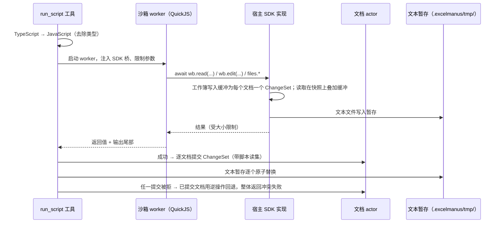

# 08 代码沙箱（`run_script`）

## 1. 用途与边界

`run_script` 让代理用 TypeScript/JavaScript 处理工具参数难以表达的逻辑：循环处理多个文件、复杂的逐行规则、自定义计算、组合多个表格操作。

**脚本负责编排，重计算交给宿主**：数据查询、聚合、表格读写都通过 SDK 调用宿主的表格引擎完成（在宿主以原生速度运行），脚本本身只做控制流与轻量计算。

## 2. 威胁模型【硬性】

脚本由模型生成，可能有 bug，也可能被文件内容中的提示词注入诱导执行恶意逻辑。沙箱必须保证：

| 要求 | 说明 |
| --- | --- |
| 不能访问宿主文件系统 | 只能通过 SDK 访问工作区，且受与工具相同的路径校验 |
| 不能访问网络 | v1 不提供任何网络能力 |
| 不能启动进程、加载原生模块、读取环境变量 | 沙箱内不存在这些 API |
| 可强制终止 | 超时或用户取消时立即终止，不依赖脚本配合 |
| 内存有上限 | 超出时终止并报告 |
| 输出有上限 | 标准输出、返回值、单次 SDK 数据传输都有大小上限 |
| 写入可回滚 | 脚本中的所有写入先暂存，成功结束才发布 |

## 3. 方案选择

| 方案 | 结论 | 原因 |
| --- | --- | --- |
| Node `vm` 模块 | 排除 | 官方明确不是安全边界 |
| `isolated-vm` | 排除 | 官方 README 声明处于维护模式 |
| Node 权限模型（`--permission`）子进程 | 排除 | 官方不将其定位为抵御恶意代码的沙箱；Windows 上缺少网络隔离 |
| 操作系统沙箱（Seatbelt / bubblewrap / Windows AppContainer） | 排除（v1） | 三个平台三套实现，维护成本高 |
| **QuickJS（WASM）运行在 `worker_threads` 中** | **采用**【推荐】 | 沙箱内只有纯 JS 引擎，宿主能力只能通过显式注入的函数访问；WASM 内存天然隔离；`quickjs-emscripten`（MIT，0.32.x）支持内存上限、中断回调、异步宿主函数；在 worker 中运行可 `terminate()` 强制终止 |

候选封装库（如基于 quickjs-emscripten 提供虚拟文件系统与 TypeScript 支持的社区包）可在 spike 中评估，但沙箱的安全属性必须由我们的测试证明，不能依赖第三方声明。

## 4. 设计【推荐】



- **TypeScript**：宿主先去除类型注解再执行（【推荐】使用 Node 内置的类型剥离能力或纯 JS 实现的转译器，不引入原生二进制）。只支持可擦除的 TS 语法。
- **运行时**：使用同步变体，宿主函数返回宿主创建的 Promise，脚本中用 `await`；worker 循环执行 pending job 驱动脚本（asyncify 变体不能在 pending job 中挂起，见 [ADR 0001](decisions/0001-run-script-sandbox-quickjs-sync.md)）。
- **限制（默认值，可配置）**：

| 项 | 默认 |
| --- | --- |
| 超时 | 30 秒（上限 300 秒） |
| QuickJS 内存 | 256 MB |
| 标准输出保留 | 最后 200 行 / 64 KB |
| 返回值 | 1 MB（JSON 可序列化） |
| 单次 SDK 调用传入/传出数据 | 32 MB |
| 同时运行的脚本 | 2 个，其余排队 |

- **终止**：中断回调检查截止时间；墙钟超时或取消时直接 `worker.terminate()`。
- **暂存与发布**：脚本对工作簿的写入不再落到文件暂存区，而是缓冲为**每个文档一个 ChangeSet**（附脚本读集）；脚本内读取看到自己缓冲的修改（在文档快照上叠加）。脚本成功结束后按文档逐个提交给文档 actor，走与普通写入相同的路径（冲突检查、修改前备份、广播，见 [07 §3.3](07-workbook-engine.md#33-一次提交的处理)）。
- **文本文件**：`files.*` 的写入仍暂存在 `.excelmanus/tmp/`（与工作区同卷），发布时逐个原子替换；文本文件冲突按内容哈希判定（`expectedVersions` 或脚本开始时读取的哈希），不符则该项不替换。
- **多文件发布的原子性**：不承诺跨文件原子事务。逐文档提交、逐文件原子替换；任一提交被拒时，已提交的文档用该批次的逆操作回退（[03 §6.3](03-architecture.md#63-跨文档)），已替换的文本文件从暂存恢复（本次新建的直接删除），整体返回 `VERSION_CONFLICT` 冲突失败。不承诺断电时的跨文件原子性，在工具说明中注明。

## 5. SDK

SDK 的能力与工具一一对应，参数与返回结构**直接复用工具的 schema**（单一事实源）：

```ts
// 示意
const ov = await wb.read({ path: "sales.xlsx", mode: "overview" });
const rows = await wb.analyze({ mode: "sql", sources: [{ name: "s", path: "sales.xlsx", sheet: "明细" }],
  sql: "select 区域, sum(金额) as 合计 from s group by 1" });
await wb.edit({ path: "out.xlsx", create: true, ops: [
  { op: "cells.set", range: "汇总!A1", values: [["区域", "合计"], ...rows.data.rows] },
] });
const list = await files.find({ glob: "uploads/*.xlsx" });
console.log(`处理了 ${list.data.entries.length} 个文件`);
```

- 可用：`wb.read`、`wb.analyze`、`wb.edit`、`wb.export`、`files.find`、`files.readText`、`files.writeText`、`files.manage`（复制/移动/建目录；删除不可用）、`console.log`。
- 不可用：`ask_user`、`agent_*`、`memory`、MCP、`run_script` 自身。
- `reader` 角色运行脚本时，写入类 SDK 调用直接报错。
- 预置少量纯 JS 工具库（【开放】如日期处理），在工具说明中列出。

## 6. 审批

`run_script` 的审批在**发布时**判断：脚本执行完毕后，按将要发布的变更（新建/修改/涉及哪些文件）套用权限模式；需要审批时缓冲的 ChangeSet 与文本暂存保留，审批请求展示将要发布的文件清单与变更摘要。批准后发布，拒绝则丢弃。

## 7. M0 技术验证【硬性】

| 验证项 | 通过标准 |
| --- | --- |
| 逃逸测试集 | 至少 30 个用例（原型链污染宿主对象、访问 `process`/`require`/`globalThis` 上的宿主引用、通过 SDK 参数进行路径穿越、超大返回值、SDK 调用递归、Promise 风暴等）全部被拦截 |
| 强制终止 | `while(true){}`、深递归、分配大数组各自在限制内被终止，宿主进程不受影响 |
| 性能 | 10 万次简单循环计算 ≤ 1 秒；一次传输 5 万行数据的 SDK 调用往返 ≤ 1 秒 |
| 冷启动 | 创建 worker + 初始化 QuickJS ≤ 300 ms（可用预热池优化） |
| 三平台 | macOS arm64/x64、Windows x64 行为一致 |
