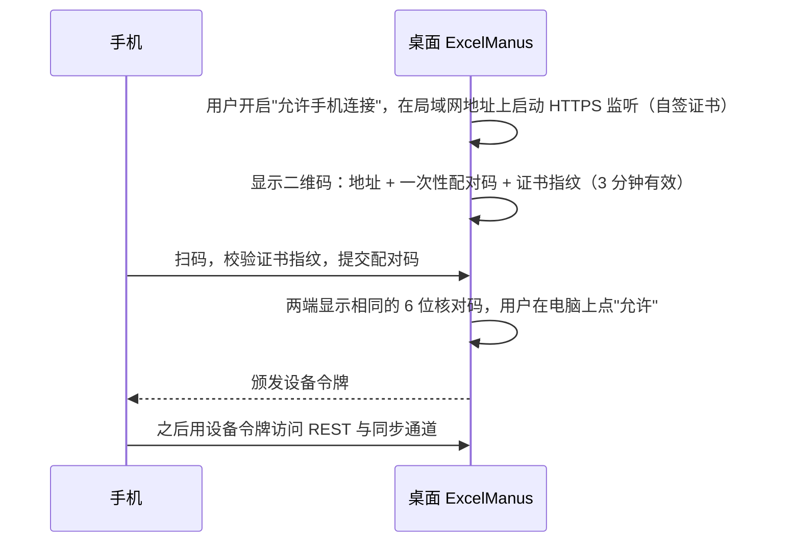

# 13 桌面与移动

## 1. 桌面架构【推荐】

桌面沿用同一前端的实际功能与交互；可借鉴 [16 页面设计参考](16-design-reference.md) 的视觉语言。草案的远程字体、图片与 CDN 不作为应用依赖，资源按 §4.1 随应用打包或使用系统资源；手机抽屉构图仅供 P2 评估，不改变 §5 的范围。

| 组件 | 职责 |
| --- | --- |
| 主进程 | 窗口与菜单、单实例锁、启动/停止后端、IPC、自动更新、`safeStorage` 主密钥、离屏截图窗口、系统通知、目录选择 |
| 后端（`utilityProcess`） | 与本机 Web 形态完全相同的后端代码，内含文档 worker 与沙箱 worker（进程图见 [03 §7.2](03-architecture.md#72-桌面)）；与主进程之间用 MessagePort 通信（端口号、访问令牌、截图请求、优雅退出），大块数据（截图）以可转移 `ArrayBuffer` 传递 |
| 渲染进程（主窗口） | 前端 SPA |
| 离屏渲染窗口 | 加载只读渲染页，为 `workbook_render` 截图（[07 §8](07-workbook-engine.md#8-工作台与截图)） |

### 1.1 稳定的前端来源

前端静态文件通过自定义协议（如 `app://excelmanus/`，注册为标准、安全、支持 fetch 与流的特权协议）加载，而不是 `http://127.0.0.1:<随机端口>`。这样即使后端端口每次不同，前端的来源也不变，本地存储（草稿、界面偏好、缓存）不会因端口变化而丢失。

- 后端监听 `127.0.0.1:0`（系统分配端口），通过 MessagePort 把端口告知主进程。
- 访问令牌由主进程经预加载脚本交给渲染进程（不放在 URL 中）。
- 后端的 CORS 只允许 `app://excelmanus` 来源。

### 1.2 渲染进程安全【硬性】

`contextIsolation: true`、`sandbox: true`、`nodeIntegration: false`；预加载脚本只暴露白名单 IPC（选择目录、打开外部链接、在文件夹中显示、更新操作、通知）；每个 IPC 校验发送方是自己的窗口；主窗口导航限制在自身来源，外部链接交给系统浏览器；OAuth 授权在系统浏览器中完成（本机回调），不在应用内嵌网页中输入第三方账号密码。

## 2. 生命周期

| 阶段 | 行为 |
| --- | --- |
| 启动 | 获取单实例锁（已运行则激活已有窗口）→ 显示启动画面 → 启动后端 → 后端就绪（数据库迁移完成、健康检查通过）→ 加载主界面。目标 ≤ 3 秒 |
| 后端崩溃 | 自动重启，最多连续 3 次；仍失败则显示错误页（原因摘要、打开日志目录、重试） |
| 渲染进程崩溃 | 自动重新加载，最多 3 次 |
| 退出 | 有代理在运行时先确认"退出将中断正在运行的任务"；有未保存的工作台编辑时提示；然后通知后端优雅退出（停止接收新请求、等待正在进行的文件提交完成、将运行中的代理标记为中断），10 秒后仍未退出则强制结束 |
| 系统休眠/唤醒 | 唤醒后前端重连同步通道；模型请求若中断按重试处理 |

## 3. 系统集成

| 功能 | 优先级 |
| --- | --- |
| 应用菜单与快捷键（[02 §10](02-interaction.md#10-快捷键桌面)） | P0 |
| 窗口不在前台时，任务完成或需要审批 → 系统通知，点击通知定位到会话 | P0 |
| 拖放文件到窗口 | P0 |
| "在 Finder/资源管理器中显示" | P0 |
| 用 ExcelManus 打开 `.xlsx`（文件关联）：打开时若文件不在任何工作区，提示登记其所在文件夹 | P1 |
| 托盘/菜单栏常驻 | P2 |

## 4. 打包与更新

### 4.1 打包【推荐】

- electron-builder；目标：macOS DMG（arm64 与 x64，或通用包）、Windows NSIS（x64）。
- **避免原生依赖**：数据库用 Electron 内置 Node 的 `node:sqlite`，沙箱用 WASM，不需要为 Electron 重新编译原生模块。若某依赖不得不带原生模块，先确认 macOS 和 Windows 都能正常打包。
- 安装包体积预算 ≤ 250 MB，`pnpm pack:desktop` 打包时检查。
- 应用内置：前端静态文件、后端代码（打包为单文件或少量文件）、内置技能、示例工作簿、models.dev 快照。

### 4.2 签名

- macOS：Developer ID 签名 + 公证（notarization）。**macOS 的自动更新要求应用已签名**，未签名的构建只能手动更新，界面需说明。
- Windows：代码签名证书（可选但强烈建议，否则 SmartScreen 警告）。
- 签名凭据只存在 CI 的密钥管理中，不进仓库。
- 开源发布阶段可以先发未签名包：签名与公证暂缓，未签名的构建手动更新（见 [backlog](backlog.md)）。

### 4.3 自动更新

- electron-updater + GitHub Releases（2026-09 核实仍为主流方案）。
- 启动时与每 24 小时检查一次；后台下载；下载完成后提示"重启以更新"。
- 有代理运行时不自动重启，等待用户确认。
- 设置中可关闭自动检查；"关于"页可手动检查。
- 更新前自动备份数据库（[10 §5](10-data.md#5-迁移与备份)）。

### 4.4 安装包自检

- 应用支持 `--self-test` 参数：启动后端、打开临时数据目录、执行一组自检（数据库读写、打开并修改示例工作簿、运行一段沙箱脚本、离屏截图、加载内置技能），输出结果并以退出码表示成功与否，不需要网络与模型。
- CI 中保留"在仓库外解压安装包后运行自检"的作业（macOS、Windows），改为手动触发（`workflow_dispatch`），发布前需要时运行。

## 5. 手机端预留（P2）

v1 不实现手机端，但以下约束 v1 就要遵守，避免将来返工【硬性】：

1. **核心功能全部通过 REST + 同步通道完成**。桌面 IPC 只用于宿主便利功能（选择目录、通知、更新），任何产品功能都不能只能通过 IPC 访问。
2. **访问令牌按设备区分**：v1 就建立"设备"概念（本机窗口是一个设备），每个设备有独立令牌（库中只存哈希），令牌可吊销。
3. **前端布局可降级到窄屏**（[02 §2.2](02-interaction.md#22-窄屏布局7681279px)），组件不假设鼠标悬停是唯一的信息入口（悬停信息要有点击替代）。
4. 同步通道与游标续传不依赖长连接不中断（手机网络经常切换）。

### 5.1 手机连接电脑的设想

- 局域网监听默认关闭；只接受已配对设备；可在设置中查看与吊销设备。
- 客户端形态：先做响应式 Web（可添加到主屏幕的 PWA），再视需要做 Android WebView 外壳。
- 手机上的核心场景：查看任务进度、审批、回答提问（含在只读表格视图上确认区域）、发送消息、查看变更摘要。复杂的表格编辑仍在电脑上完成。
- 局域网之外的远程访问（中继服务）为 P3，届时在"连接"抽象上增加 `relay` 类型，不影响 API。

### 5.2 手机页面初步参考

后补 `stitch_/` 的两页草稿已整理为 [16 §7](16-design-reference.md#7-手机页面参考p2)，包含表格浏览与会话对话的存档、可借鉴组件、差异处理和 P2 复核流程。它是初步参考，不要求一比一复刻；最终布局依据上述手机任务与真实同步状态，触摸选区、软键盘、安全区域、后台重连与设备吊销需要在手机阶段验证。

草案的麦克风、逐项应用、自动预审与置信度不构成新能力承诺；复杂表格编辑仍在电脑上完成，配对、设备令牌与同步通道要求不变。最终导航与页面组织保持开放，不能用缩小视口或草案截图作为实机验收证据。

## 6. 服务器部署预留（P2）

同一后端以服务器模式运行时需要：

- 监听非回环地址时**必须**启用登录保护（单管理员账号密码，会话 Cookie `HttpOnly`/`Secure`/`SameSite=Strict`，登录限流），否则拒绝启动。
- 通过反向代理提供 HTTPS；同步通道（WebSocket）需关闭代理缓冲并允许 Upgrade。
- 默认禁用 stdio MCP（服务器上执行任意命令风险高），需显式开启。
- 截图渲染使用无头 Chromium。
- 仍是单用户实例；多人使用应部署多个实例。
- 提供 Docker 镜像。
